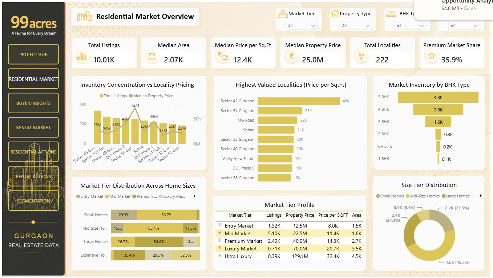
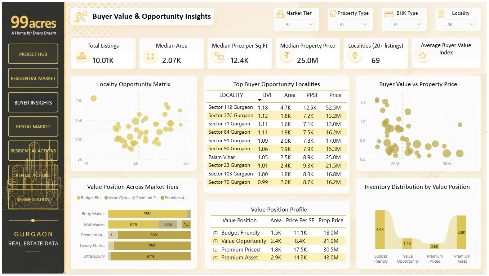
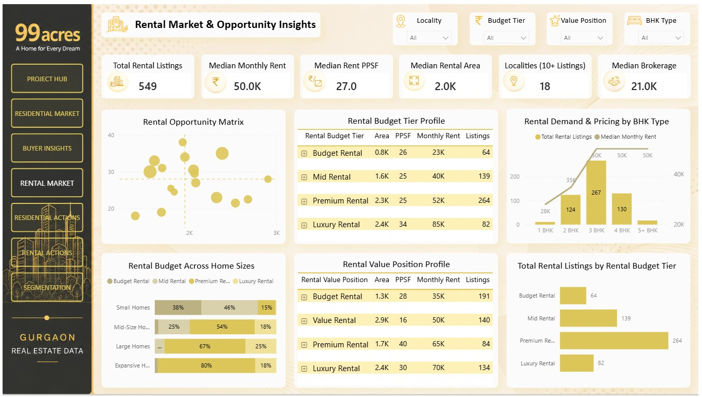

```{=html}
<p align="center">
```
``{=html}
```{=html}
</p>
```
# Gurgaon Real Estate Market & Opportunity Analytics

### 99acres · Python EDA · Power BI · Residential Sales & Rental Markets

> **From raw property listings to structured market intelligence and
> buyer-oriented opportunity analysis.**

This project follows an end-to-end analytical journey using residential
property listings from 99acres.com. It begins with a broad, mixed raw
dataset, develops a defensible analytical foundation in Python, and then
uses Power BI to explore the sales and rental markets through separate
analytical views.

The work is intentionally presented as a connected journey rather than
as a collection of unrelated charts. Python EDA focuses on residential
sales; the Power BI report presents separate sales and rental analyses:

**Raw data → data understanding → analytical preparation → validation →
feature engineering → Python EDA → Power BI analysis → market
interpretation.**

The project is exploratory and decision-support oriented. It is not a
property valuation model, investment recommendation, or prediction
system.

------------------------------------------------------------------------

## ■ Project at a Glance

  -----------------------------------------------------------------------
  Component                           Description
  ----------------------------------- -----------------------------------
  Data source                         Indian Real Estate -- 99acres.com
                                      (Kaggle)

  Geography                           Gurgaon, India

  Analytical environments             Python and Power BI

  Python libraries                    Pandas, NumPy, Matplotlib, Seaborn

  BI capabilities                     Power Query, data modelling, DAX,
                                      interactive dashboards

  Sales dataset used in Power BI      10,010 rows · 23 columns

  Rental dataset used in Power BI     549 rows · 21 columns

  Final Power BI pages                5

  Primary analytical lenses           Residential sales, buyer
                                      value/opportunity, residential
                                      rentals
  -----------------------------------------------------------------------

**Source dataset:** [Indian Real Estate -- 99acres.com on
Kaggle](https://www.kaggle.com/datasets/arvanshul/gurgaon-real-estate-99acres-com)
by **arvanshul**.

The source is a third-party dataset derived from property listings. The
analysis reflects the available listing data and should not be
interpreted as verified transaction or registration data.

## ■ Why This Project Matters

Residential property listings contain useful market signals, but those signals are difficult to interpret when the data is fragmented, inconsistent or viewed only through headline prices. This project demonstrates how raw listing data can be converted into a more structured analytical resource for understanding a residential market.

Its value is practical:

- **A clearer view of the market:** Separate sales and rental analyses help readers understand two different pricing environments without treating sale prices and monthly rents as directly comparable.
- **More meaningful property comparisons:** Area-normalized pricing, property-size bands and market tiers provide context beyond headline asking prices.
- **Locality-level perspective:** Inventory concentration, median pricing and the custom Buyer Value Index bring multiple locality signals into one analytical view.
- **A transparent analytical process:** The project documents data-quality decisions, anomaly handling, segmentation rules and the limitations of the source rather than presenting dashboard outputs without context.
- **End-to-end analytics capability:** It demonstrates how Python-based preparation and exploration can feed a Power BI report designed around business questions and user-facing interpretation.

For a buyer or market researcher, the report can help narrow areas or segments for further investigation. For an analyst, it demonstrates the ability to move from an imperfect source dataset to documented analysis and an interactive reporting experience.

**The project is a decision-support and portfolio case study—not a property recommendation engine, formal valuation, investment advice or representation of completed market transactions.** Its findings should be used as directional signals for further investigation, not as substitutes for property-level due diligence.

---

## ■ The Business Problem

A property's headline price is rarely enough to understand its market
position. Two properties with different sizes, configurations and
localities cannot be meaningfully compared by total price alone.

For buyers, investors and market researchers, useful questions include:

-   Which property characteristics are associated with higher listed
    prices?
-   How do property size and locality influence the pricing landscape?
-   Which localities have strong pricing levels, and how much listing
    inventory sits behind those levels?
-   Does a lower price per square foot indicate a potentially stronger
    space-to-price proposition?
-   Does the luxury segment behave differently from the wider market?
-   How does the rental market compare across budget, size and locality
    categories?

The project addresses these questions in two stages. Python is used to
understand, prepare and investigate the source data. Power BI then turns
the prepared sales and rental datasets into interactive market views and
locality-level opportunity analysis.

## ■ End-to-End Analytical Workflow

``` text
99ACRES RAW LISTINGS
        |
        v
INITIAL DATA INSPECTION
        |
        v
FEATURE REVIEW & DATA REDUCTION
        |
        v
SALES / RENTAL SEPARATION
        |
        v
PYTHON DATA CLEANING & VALIDATION
        |
        v
FEATURE ENGINEERING
        |
        v
EXPLORATORY DATA ANALYSIS
        |
        v
CLEAN SALES & RENTAL CSVs
        |
        v
POWER BI / POWER QUERY
        |
        v
DAX MEASURES & BUSINESS SEGMENTATION
        |
        v
FIVE-PAGE INTERACTIVE DASHBOARD
        |
        v
MARKET, LOCALITY & VALUE INTERPRETATION
```

------------------------------------------------------------------------

## ■ 1. Raw Dataset: Understanding the Source

The original dataset contained approximately **10,704 property listings
and 67 columns**. It included both sale and rental listings, alongside
property characteristics, price and area fields, locality information,
listing metadata, amenity-related fields, image references, contact
information and other scraped attributes.

The source was not ready for direct analysis. It contained fields with
different levels of analytical usefulness, inconsistent representations
and missing values. The first task was therefore to understand the
source before deciding what to retain, transform or exclude.

### Initial inspection

The Python workflow began with:

-   Loading the raw CSV into a Pandas DataFrame.
-   Reviewing dimensions, column names and data types.
-   Inspecting sample records and descriptive statistics.
-   Auditing null values and field completeness.
-   Reviewing category values and the meaning of key fields.
-   Identifying fields that were relevant to residential market analysis
    versus fields that were primarily listing, scraping or presentation
    metadata.

### Reducing the analytical schema

The original 67-column source was reviewed to identify the fields
required for pricing, property configuration, locality analysis and
downstream dashboarding. Redundant or non-analytical fields were reduced
so the resulting datasets could be used more clearly and consistently.

This was a purposeful analytical reduction---not an assumption that
every source column was useful simply because it was available.

### Separating sales and rental listings

The source contained two different market types:

-   **Sales:** one-time property asking prices.
-   **Rentals:** recurring monthly rental amounts.

These pricing mechanisms are fundamentally different. Combining them in
one valuation distribution would make price comparisons misleading. The
source was therefore separated into independent sales and rental
datasets, and the Python sales EDA focused on the residential sales
market.

The rental records were retained as a separate analytical dataset for
the Power BI rental analysis.

------------------------------------------------------------------------

## ■ 2. Python: Data Preparation and Quality Decisions

The cleaning process was guided by the meaning of each field. A single
blanket treatment for all missing or unusual values would have risked
distorting the dataset.

### Missing-value treatment

The documented field-level decisions included:

  -----------------------------------------------------------------------
  Field                   Treatment               Analytical reason
  ----------------------- ----------------------- -----------------------
  `PRICE`                 Median imputation       Property prices are
                                                  skewed; median is less
                                                  sensitive to extreme
                                                  values than the mean.

  `AREA`                  Remove records where    Area is required for a
                          area is missing         meaningful
                                                  price-per-square-foot
                                                  calculation.

  `BEDROOM_NUM`           Mode-based treatment    Retains records while
                                                  using the most frequent
                                                  observed configuration.

  `BALCONY_NUM`           Zero where appropriate  Represents listings
                                                  with no balcony rather
                                                  than an unknown
                                                  positive count.

  `FLOOR_NUM`             Median-based treatment  Provides a numeric
                                                  treatment for missing
                                                  floor information.

  `BROKERAGE`             Zero where absence      Preserves the
                          represents no brokerage distinction between no
                          value                   brokerage amount and a
                                                  missing analytical
                                                  price.
  -----------------------------------------------------------------------

These are the decisions documented in the Python EDA. Their
appropriateness depends on the interpretation of the source fields; they
should not be generalized to unrelated datasets without validation.

### Area anomaly investigation

Area is a key input to price-per-square-foot analysis. Implausibly small
or extreme area values can distort both property-level and
locality-level comparisons.

Instead of applying a threshold without investigation, the workflow
examined low and high area observations before defining a usable
analytical range.

The final sales EDA retained properties within:

**250--50,000 sq.ft.**

The sequence was:

**Detect → inspect → understand → define a rule → filter → assess the
result.**

### Price-per-square-foot validation

Price per square foot was used as a normalized pricing measure:

``` python
PRICE_SQFT = PRICE / AREA
```

This helps compare properties with different floor areas, although it
does not remove the influence of locality, configuration, condition or
listing quality.

The PPSF distribution was examined for extreme values. The final
lower-tail treatment used an approximately **1st-percentile threshold of
₹5,222 per sq.ft.** The resulting sales EDA dataset contained **10,010
records**.

The thresholds are project-specific analytical rules, not universal
real-estate standards.

------------------------------------------------------------------------

## ■ 3. Python: Exploratory Analysis and Analytical Reasoning

Once the sales data had been prepared and validated, the analysis moved
from data quality into market structure, pricing relationships and
locality-level comparisons.

### Market structure

The EDA examined the composition of the residential sales listings
across property configurations, BHK, area and price. This established
the shape of the observed listing market before drawing conclusions
about pricing or value.

### Property characteristics and price association

The analysis compared property price with selected numeric attributes.
The observed correlations were:

  Attribute     Correlation with listed price
  ----------- -------------------------------
  Area                                 \~0.48
  Bathrooms                            \~0.26
  BHK                                  \~0.25
  Balconies                            \~0.11

Area showed the strongest linear association among these selected
attributes. These are correlations within the analyzed listings; they do
not establish that a feature causes a price change, and they do not
account for every factor affecting property prices.

### Locality intelligence

Localities were compared using listing concentration, median property
price and median PPSF. Minimum listing thresholds were used for selected
comparisons to reduce the influence of localities represented by very
small samples.

The analytical question shifted from simply finding the most expensive
locality to understanding the relationship between:

-   the level of listed inventory;
-   the typical price level;
-   the typical price per square foot; and
-   the size profile of properties in that locality.

### Locality space-to-price efficiency

Headline price and PPSF answer different questions. The locality
analysis therefore considered price levels alongside property size and
PPSF to distinguish between expensive markets, larger-property markets
and locations that may offer stronger space-to-price efficiency.

A lower PPSF can indicate a more attractive space-to-price relationship
in the observed listings, but it is not by itself proof of better
construction quality, investment returns or future appreciation.

### Luxury market profiling

The top 10% of sales listings were profiled separately from the
remaining 90%. The comparison considered price, area, PPSF and property
configuration.

The purpose was to test whether the luxury segment had a sufficiently
different profile to warrant its own analytical lens, rather than
treating it as merely the upper end of one continuous market.

### Python EDA conclusion

The Python stage established the analytical foundation used downstream:

-   Area had the strongest measured association with listed price among
    the selected structural attributes.
-   Locality remained an important lens for understanding pricing
    differences.
-   Inventory concentration and pricing level were not interchangeable.
-   PPSF provided a more comparable lens across properties of different
    sizes.
-   The top-decile luxury segment displayed a distinct profile in the
    EDA.

These findings are descriptive and exploratory, not predictive.

------------------------------------------------------------------------

## ■ 4. From Python to Power BI: Prepared Analytical Datasets

The prepared CSVs used in the Power BI project were:

  Dataset                   Rows   Columns Purpose
  --------------------- -------- --------- ---------------------------
  `gurgaon_sales.csv`     10,010        23 Residential sales market
  `gurgaon_rent.csv`         549        21 Residential rental market

The Power BI sales dataset includes the `BHK_GROUP` and `MARKET_SEGMENT`
fields used in the sales analysis. The two datasets are loaded as
**independent tables**. They are not connected to each other through
relationships in the Power BI model.

This separation is intentional in the current implementation: the sales
pages analyse sales listings, while the rental page analyses rental
listings. The dashboard does not claim to combine the two markets into a
common transaction model.

### Power Query preparation

The Power Query workflow was deliberately lean because the major
cleaning and analytical preparation had already taken place in Python.

The visible query steps were:

1.  `Source`
2.  `Promoted Headers`
3.  `Changed Type`

The queries were named `gurgaon_sales` and `gurgaon_rent`. The final
imported datasets contained 23 sales columns and 21 rental columns
respectively.

------------------------------------------------------------------------

## ■ 5. Power BI: Segmentation and Business Definitions

Segmentation makes a large and varied property market easier to compare.
The categories used in this project are **project-defined analytical
frameworks**, not official industry classifications.

The thresholds were not selected arbitrarily. The segmentation work
used a combination of **distribution analysis, dataset medians and
percentile-based investigation** to understand the data and establish
meaningful comparison points. Median-based splits are used where a
relative comparison is intended; percentile analysis was also used in
data validation, including the lower-tail PPSF threshold. Price, rent
and area bands are explicit analytical boundaries informed by the
observed data and the reporting objectives; they should not be
misrepresented as all being percentile cut-offs.

### Sales market tiers

| Market tier | Listed property price |
|---|---:|
| Entry Market | Below ₹1.5 Cr |
| Mid Market | ₹1.5 Cr to below ₹3 Cr |
| Premium Market | ₹3 Cr to below ₹6 Cr |
| Luxury Market | ₹6 Cr to below ₹10 Cr |
| Ultra Luxury | ₹10 Cr and above |

### Sales home-size tiers

| Size tier | Area |
|---|---:|
| Small Homes | Below 1,500 sq.ft. |
| Mid-Size Homes | 1,500 to below 2,500 sq.ft. |
| Large Homes | 2,500 to below 4,000 sq.ft. |
| Expansive Homes | 4,000 sq.ft. and above |

### Sales value position

Each property's listed price and area are compared with the **overall
sales-dataset medians**.

| Value position | Price condition | Area condition |
|---|---|---|
| Budget Friendly | At or below median price | At or below median area |
| Value Opportunity | At or below median price | Above median area |
| Premium Priced | Above median price | At or below median area |
| Premium Asset | Above median price | Above median area |

This framework distinguishes properties that are relatively more
affordable, larger for their price, higher-priced despite smaller size,
or both higher-priced and larger. It is a relative classification based
on the dataset medians, not an appraisal.

### Rental budget tiers

| Rental tier | Monthly rent |
|---|---:|
| Budget Rental | Below ₹30,000 |
| Mid Rental | ₹30,000 to below ₹50,000 |
| Premium Rental | ₹50,000 to ₹75,000 |
| Luxury Rental | Above ₹75,000 |

### Rental home-size tiers

The rental dashboard uses the same area bands as the sales size
framework.

| Size tier | Area |
|---|---:|
| Small Homes | Below 1,500 sq.ft. |
| Mid-Size Homes | 1,500 to below 2,500 sq.ft. |
| Large Homes | 2,500 to below 4,000 sq.ft. |
| Expansive Homes | 4,000 sq.ft. and above |

### Rental value position

The rental framework compares monthly rent and area against their
**respective rental-dataset medians**.

| Value position | Monthly rent condition | Area condition |
|---|---|---|
| Budget Rental | At or below median rent | At or below median area |
| Value Rental | At or below median rent | Above median area |
| Premium Rental | Above median rent | At or below median area |
| Luxury Rental | Above median rent | Above median area |

------------------------------------------------------------------------

## ■ 6. Power BI: DAX and Buyer Value Intelligence

The Power BI report uses separate measure tables for the two sales pages
and the rental page. The measures support KPI cards, locality
comparisons, market segmentation and the buyer-value framework.

Rather than listing every measure, this README highlights the analytical
logic that gives the report its distinctive value.

### Buyer Value Index (BVI)

The Buyer Value Index is a custom weighted locality-level score designed
to combine three dimensions:

``` dax
Buyer Value Index =
IF(
    [Total Listings] < 50,
    BLANK(),
    [Area Score] * 0.3 +
    [PPSF Score] * 0.5 +
    [Inventory Score] * 0.2
)
```

The current weighting assigns:

-   30% to Area Score;
-   50% to PPSF Score;
-   20% to Inventory Score.

Localities with fewer than 50 listings are excluded from this measure
through a blank result. The index is intended to compare qualifying
localities within this dataset. It is a custom relative analytical
score---not an official valuation, investment-return estimate or causal
measure.

**Component definition requiring final technical confirmation:** the
exact `Area Score` DAX has not yet been included in the material used
for this draft. Its precise calculation and interpretation should be
documented only after that formula is checked.

### PPSF Score

``` dax
PPSF Score =
IF(
    [Total Listings] < 50,
    BLANK(),
    DIVIDE(
        CALCULATE(
            [Median PPSF],
            ALL(gurgaon_sales[LOCALITY])
        ),
        [Median PPSF]
    )
)
```

This compares the overall median PPSF with the current locality's median
PPSF. A locality with a lower median PPSF receives a higher relative
score, subject to the listing qualification rule.

### Inventory Score

``` dax
Inventory Score =
IF(
    [Total Listings] < 50,
    BLANK(),
    DIVIDE(
        [Total Listings],
        CALCULATE(
            [Total Listings],
            ALL(gurgaon_sales[LOCALITY])
        )
    )
)
```

This expresses a locality's listing count as a share of the total
listing count across localities, while applying the 50-listing
qualification rule.

### Buyer Value Rank

``` dax
Buyer Value Rank =
RANKX(
    ALL(gurgaon_sales[LOCALITY]),
    [Buyer Value Index],
    ,
    DESC
)
```

This ranks localities by Buyer Value Index in descending order.

### Rental locality qualification

``` dax
Qualified Rental Localities =
COUNTROWS(
    FILTER(
        VALUES(gurgaon_rent[LOCALITY]),
        CALCULATE(
            DISTINCTCOUNT(gurgaon_rent[PROP_ID])
        ) >= 10
    )
)
```

This counts localities with at least 10 distinct rental property IDs. It
supports the rental dashboard's qualified-locality KPI.

**Interpretation note:** the BVI formula, its component scores and its
qualification threshold should be read together. A higher BVI is a
stronger result under this project's chosen weighting and dataset rules;
it should not be interpreted as a guarantee of better investment
performance.

------------------------------------------------------------------------

## ■ 7. Power BI: Dashboard Experience

The README showcases the report's **three primary analytical pages**.
The project hub and the separate segmentation reference page are
intentionally omitted here to keep the presentation focused.

### 01 — Residential Market Overview



This page establishes the structure of Gurgaon's observed sales market.

**Headline indicators shown:**

- Total Listings: 10.01K
- Median Area: 2.07K sq.ft.
- Median Price per Sq.Ft.: ₹12.4K
- Median Property Price: ₹25.0M
- Total Localities: 222
- Premium Market Share: 35.9%

**Analytical views include:**

- Inventory concentration versus locality pricing;
- highest-valued localities by PPSF;
- market inventory by BHK type;
- market-tier distribution across home sizes;
- market-tier profile; and
- size-tier distribution.

### 02 — Buyer Value & Opportunity Intelligence



This page moves from describing the market to comparing locality-level
value signals.

**Headline indicators shown:**

- Total Listings: 10.01K
- Median Area: 2.07K sq.ft.
- Median PPSF: ₹12.4K
- Median Property Price: ₹25.0M
- Average Buyer Value Index
- A qualified-locality count shown on the page

**Analytical views include:**

- Locality Opportunity Matrix;
- top buyer-opportunity localities table;
- Buyer Value versus Property Price;
- value position across market tiers;
- value-position profile; and
- inventory distribution by value position.

The BVI is intended to help compare qualifying localities across the
project's selected area, PPSF and inventory dimensions. It should be
interpreted alongside the component measures and the underlying listing
counts.

### 03 — Rental Market & Opportunity Intelligence



The rental page provides a separate view of monthly rent, rental area,
rental PPSF, locality coverage and rental budget segments.

**Headline indicators shown:**

- Total Rental Listings: 549
- Median Monthly Rent: ₹50.0K
- Median Rent PPSF: ₹27
- Median Rental Area: 2.0K sq.ft.
- Qualified Localities: 18
- Median Brokerage

**Analytical views include:**

- Rental Opportunity Matrix;
- rental budget-tier profile;
- rental demand and pricing by BHK type;
- rental budget across home sizes;
- rental value-position profile; and
- rental listings by rental budget tier.

------------------------------------------------------------------------

## ■ 8. Key Dashboard Signals

The report surfaces several useful descriptive signals from the prepared
listing data:

-   The sales dataset contains 10,010 listings across 222 localities.
-   The sales dashboard reports a median listed property price of ₹25.0M
    and median PPSF of ₹12.4K.
-   The dashboard reports a premium-market share of 35.9% under the
    project's market-tier definitions.
-   The buyer-opportunity page highlights locality comparisons using the
    custom BVI framework.
-   The rental dataset contains 549 listings, with a median monthly rent
    of ₹50K.
-   The rental page identifies 18 localities meeting its 10-listing
    qualification rule.

These are dashboard-level descriptive outputs. They depend on the
filters, definitions and prepared datasets used in the report; they
should not be read as complete market census figures or verified
transaction statistics.

------------------------------------------------------------------------

## ■ 9. Project Deliverables & Access

### Interactive Power BI report

[**Open the interactive Power BI
dashboard**](https://app.powerbi.com/view?r=eyJrIjoiMTE2YTIyOTAtMTg5My00ZDUzLWI1MDAtNWI1OTI0YWYyZDcxIiwidCI6ImM2ZTU0OWIzLTVmNDUtNDAzMi1hYWU5LWQ0MjQ0ZGM1YjJjNCJ9&pageName=0962e69e2cd01d3a50ec)

### Power BI Desktop file

`power-bi/99 Acre Gurgaon Real Estate Market & Opportunity Analytics.pbix`

The PBIX file contains the interactive report for inspection in Power BI
Desktop.

### Static report

`deliverables/Gurgaon Real Estate Market & Opportunity Analytics.pdf`

The PDF is a 9-page static presentation containing the report pages and additional locality-level examples
and additional sales- and rental-market examples.

### Python EDA — complete analytical record

The Python stage is included in four complementary formats so reviewers
can inspect the work at the level they prefer:

- **[Jupyter Notebook](python/notebook/gurgaon_residential_sales_eda.ipynb)** — original Python code, execution outputs and exploratory charts.
- **[HTML notebook](python/rendered/gurgaon_residential_sales_eda.html)** — browser-readable version of the notebook.
- **[PDF notebook](python/rendered/gurgaon_residential_sales_eda.pdf)** — 55-page document following the notebook's analytical sequence.
- **[Analytical Journey Carousel](python/presentation/gurgaon_analytical_journey_carousel.pptx)** — 16-slide visual walkthrough of the business problem, data inspection, feature reduction, standardisation, data repair, engineering, validation and EDA.

The carousel is an executive-friendly guide to the Python workflow; the
notebook, HTML and PDF provide the detailed analytical record. Together,
they make the Python stage understandable without requiring a reviewer
to execute the notebook.

### Combined repository structure

```text
gurgaon-real-estate-market-opportunity-analytics/
│
├── README.md
├── .gitignore
│
├── python/
│   ├── notebook/
│   │   └── gurgaon_residential_sales_eda.ipynb
│   ├── rendered/
│   │   ├── gurgaon_residential_sales_eda.html
│   │   └── gurgaon_residential_sales_eda.pdf
│   └── presentation/
│       └── gurgaon_analytical_journey_carousel.pptx
│
├── data/
│   ├── gurgaon_sales.csv
│   └── gurgaon_rent.csv
│
├── images/
│   ├── project-cover.png
│   ├── dashboard-01-residential-market-overview.jpg
│   ├── dashboard-02-buyer-value-opportunity.jpg
│   └── dashboard-03-rental-market-opportunity.jpg
│
├── power-bi/
│   └── 99 Acre Gurgaon Real Estate Market & Opportunity Analytics.pbix
│
└── deliverables/
    └── Gurgaon Real Estate Market & Opportunity Analytics.pdf
```


## ■ Tools & Skills Demonstrated

| Tool | What was done in this project |
|---|---|
| **Python** | Used as the main environment for data inspection, preparation, cleaning, feature engineering and exploratory analysis. |
| **Pandas** | Inspected dataset structure; selected and renamed fields; separated sales and rental records; handled missing values; filtered anomalies; grouped and aggregated data; prepared analysis-ready datasets. |
| **NumPy** | Supported numerical operations and statistical calculations during data preparation and analysis. |
| **Matplotlib** | Created exploratory visualizations to examine distributions, relationships and market patterns. |
| **Seaborn** | Visualized distributions, correlations and relationships between property characteristics and listed prices. |
| **Power Query** | Imported the prepared sales and rental CSVs into Power BI, promoted headers and assigned data types. |
| **DAX** | Built measures and calculated columns for market segmentation, locality qualification, ranking, market share and the weighted Buyer Value Index. |
| **Power BI** | Designed interactive sales, buyer-opportunity and rental dashboards to communicate market structure and locality-level signals. |

------------------------------------------------------------------------

## ■ Author

**Debanjan Biswas**

**Tools used in this project:** Python · Pandas · NumPy · Matplotlib · Seaborn · Power Query · DAX · Power BI

**Email:** [biswasdebanjan99@gmail.com](mailto:biswasdebanjan99@gmail.com)  
**Phone:** 7439243559  
**LinkedIn:** [linkedin.com/in/biswas-debanjan-2ab011148](https://www.linkedin.com/in/biswas-debanjan-2ab011148/)

------------------------------------------------------------------------

```{=html}
<p align="center">
```
**Raw Listings → Analytical Foundation → Market Intelligence →
Opportunity Analysis**

*Gurgaon Real Estate Market & Opportunity Analytics*

```{=html}
</p>
```
